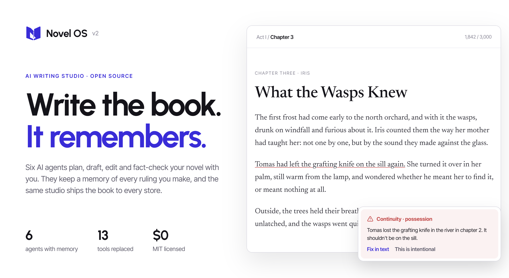
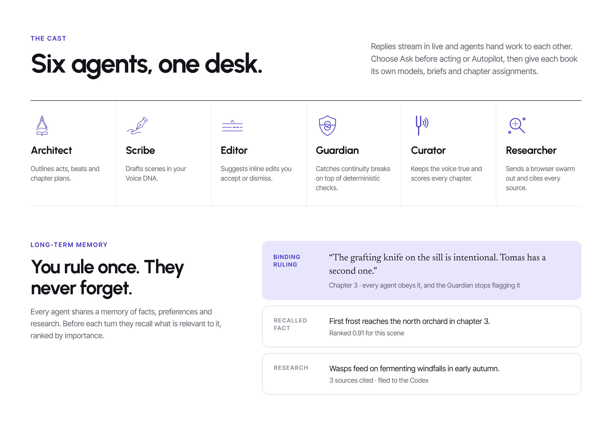
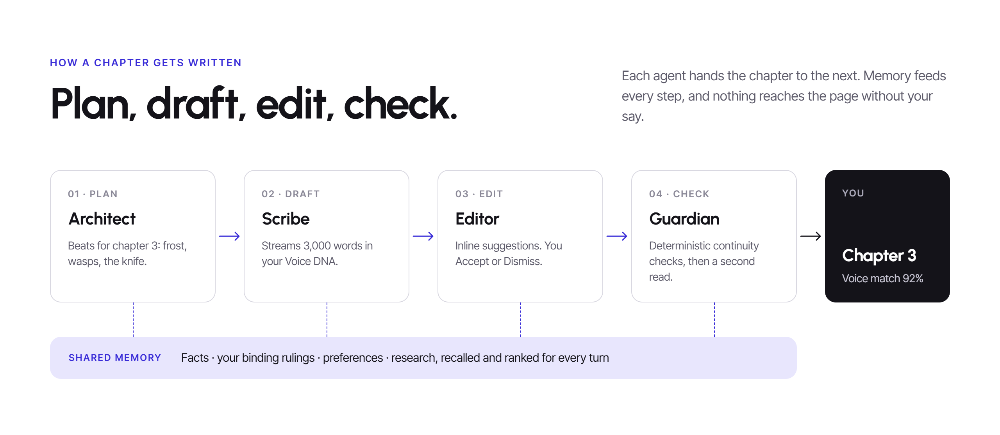
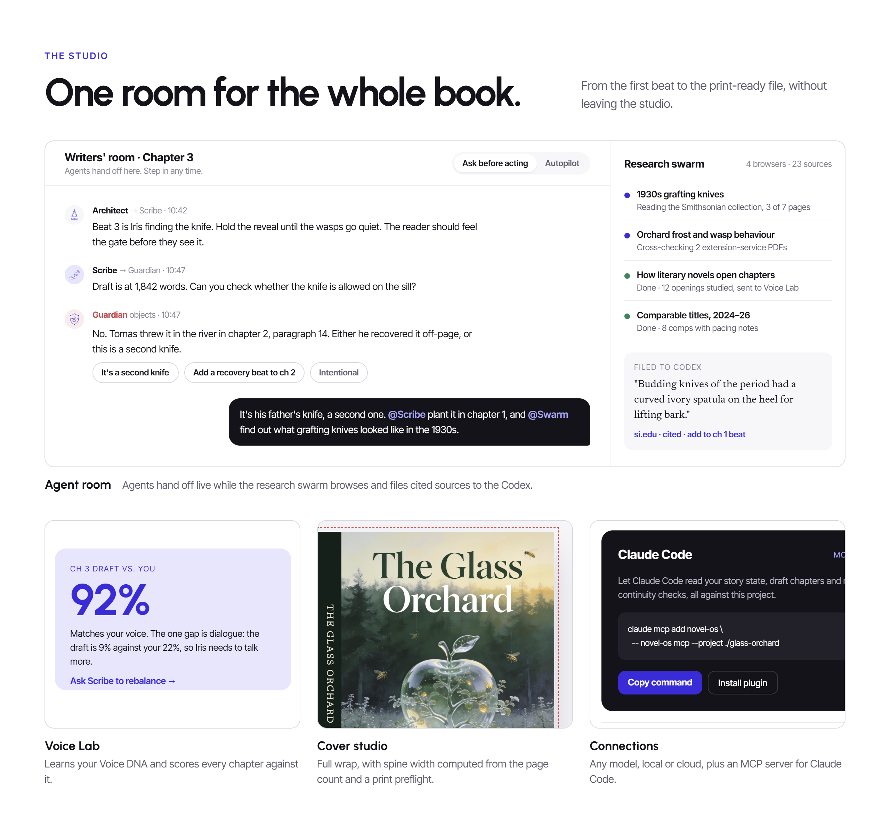
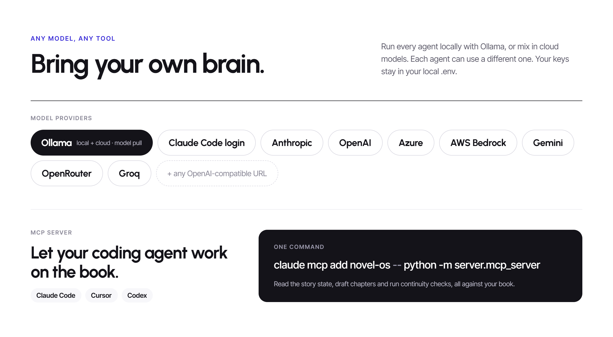
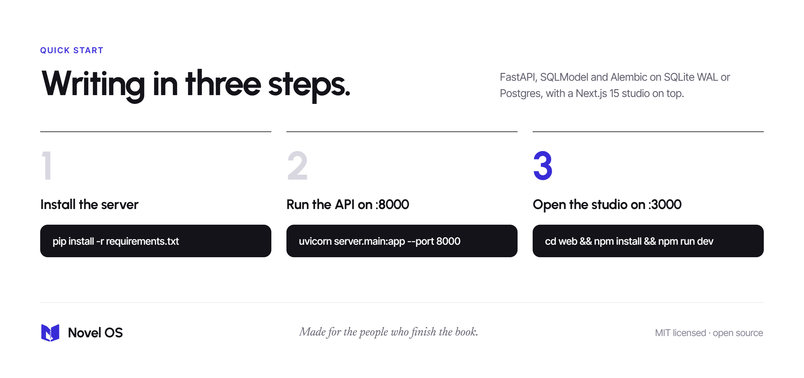

<p align="center"></p>

<h1 align="center">Novel OS</h1>
<p align="center"><strong>The writing studio that remembers chapter 3.</strong><br>
A team of AI agents with real memory, a research swarm that cites its sources, and everything you need to ship the book.</p>

<p align="center"></p>

<p align="center"></p>

---

## What it does

| | |
|---|---|
| **Manuscript** | Chapters by act, a calm book-typeset editor, autosave, snapshots and version diffs, a Codex of characters, places and lore. |
| **Agent room** | Architect, Scribe, Editor, Guardian, Curator and Researcher. Assign agents to chapters, give each its own model, @mention them, and watch them hand work to each other ("Ask before acting" or Autopilot). |
| **Memory** | Agents remember facts from every chapter, your rulings ("this is intentional"), your preferences and what research found. Recall is ranked by relevance, importance and recency, and you can pin, edit or delete any memory. |
| **Continuity** | Deterministic checks (dormant threads, absent characters, the dead walking, lost objects reappearing) plus a Guardian agent. |
| **Research swarm** | Parallel browser agents (headless Chromium if installed) search, read and quote. Findings carry citations and file straight into the Codex. |
| **Voice Lab** | Learns your Voice DNA from your own writing, scores every chapter against it, and steers the Scribe. |
| **Ship** | Media library, a cover studio with spine width from live page count and print preflight, one metadata vault for every store, launch checklists, EPUB/DOCX/PDF/HTML/MD export, and a marketing kit. |
| **Bring any model** | Ollama Cloud or local, Claude Code login, Anthropic, OpenAI, Gemini, OpenRouter, Groq and more, set per role or per agent. |
| **Claude Code / MCP** | `claude mcp add novel-os -- python -m server.mcp_server` lets Claude Code, Cursor or Codex read canon, write chapters and run continuity. |

<p align="center"></p>

<p align="center"></p>

<p align="center"></p>

## Run it

<p align="center"></p>

```bash
pip install -r requirements.txt
uvicorn server.main:app --port 8000          # API, agents, database
cd web && npm install && npm run dev         # Studio → http://localhost:3000
```

Optional:
- `pip install playwright && playwright install chromium` gives the research swarm a real browser.
- `OLLAMA_API_KEY=...` in `.env` makes Ollama Cloud the default model.

Data lives in `./data` (SQLite, WAL). Set `NOVEL_OS_DATABASE_URL=postgresql+psycopg://…` for Postgres.

## Architecture

- `server/`: FastAPI and SQLModel. One gateway for every model call (`server/llm.py`), a job runner for agent work, Server-Sent Events for live updates, and auto-mounted routers.
- `core/`: the engine (provider clients, continuity, compile, style stats).
- `web/`: Next.js 15 App Router, TanStack Query, lucide icons.
- `agents/*/prompt.md`: role prompts.

See [`docs/BUILD.md`](docs/BUILD.md) for the full contract.

## Test

```bash
python -m pytest
cd web && npm run typecheck && npm run lint && npx next build
```

## License

Novel OS is free software, licensed under the **GNU Affero General Public License v3.0 or later** ([LICENSE](LICENSE)).
You can use, study, change and share it. If you modify Novel OS and let people use it over a network
(for example, hosting it as a service), you must offer them the source of your modified version under the same license.

Copyright (c) 2026 Mriganka Dey.
